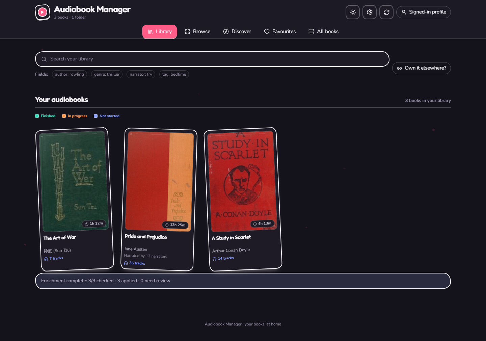

# Design lab — gallery

An experimental, evolutionary GUI overhaul for Bookle, inspired by Human Made's
[self-optimising WordPress](https://humanmade.com/word-on-the-future/self-optimising-wordpress/):
agent-generated variants, scored by a vision model against a hidden rubric, iterated on a
checkpointed branch. See `scripts/design-lab-capture.js` for the capture harness and
`ledger.json` beside this file for the machine-readable history.

**Honesty notes (read once):**

- Fitness measures *judge-perceived quality against a hidden rubric*, not measured
  household behaviour. There is no conversion funnel in a family app, and no amount of
  judging conjures one. What this can produce: increasingly bold, increasingly polished
  screens, chosen ruthlessly. What it cannot produce: evidence that they land with the
  household. That verdict stays with the people who live here — at merge time, not in
  the loop.
- The hidden rubric (`rubric.md`, kept outside this repo by design) weights legibility,
  hierarchy, touch ergonomics, household warmth, dark-mode craft, phone-first composition,
  status clarity, distinctiveness, composition discipline and coherence. Generator agents
  never see it; judge agents score against it.
- Every generation is a git tag. Rolling back to any design in this gallery is a checkout,
  not archaeology.
- Screenshots are of the seeded fixture library (LibriVox, public domain). No household
  data appears here.

**Status:** Phase 0 complete except judge calibration — the OpenCode free tier was
exhausted on 2026-11-14, so the VL judge calibration runs first on 2026-11-15.
Tournament results begin with Gen 1.

## How to read an entry

Each generation lists its concept, its fitness, the judge's one-line verdict, and the
screens at 390px (phone, light and dark) and 1440px (desktop). Git tags are named
`design-lab/gen<N>/<role>` where role is `champion` or a losing seed (`v1`, `v2`, …).
Losing seeds are kept, not deleted — extinction is part of the record.

---

## Gen 0 — baseline

- Tag: `design-lab/gen0/champion` · captured 2026-11-14 · commit `c22f573`
- Concept: shipped post-spec-15b client — injection-moulded capsule vending, drawn by hand
- Guards: layout, sideways-scroll, detail-dialog fit, leaked comments — **pass**
- Fitness: unmeasured (baseline seed)

### Phone — light

| Library | Detail | Browse |
|---|---|---|
|  |  |  |

### Phone — dark

| Library | Browse |
|---|---|
|  |  |

### Desktop — light / dark

| Light (full page) | Dark (full page) |
|---|---|
|  |  |
